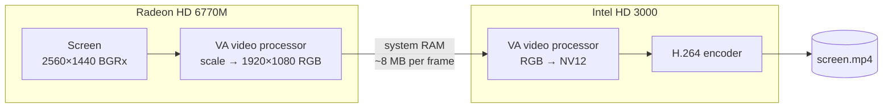

# imac-2011-linux

Notes and fixes for running Linux on a mid-2011 27" iMac (**iMac12,2**). Tested on Fedora 45, kernel 7.3, GNOME on Wayland.

| Problem | Fix |
|---|---|
| HDD fan runs loud after replacing the Apple hard drive with an SSD | [imac-hddfan](https://github.com/zimchaa/imac-hddfan) |
| Faint moving "snow" on dark greys that isn't there in macOS | [`radeon-nodither/`](radeon-nodither/) |
| Games run slowly because they render on the Intel GPU | [Disable switcheroo-control](#games-running-on-the-intel-gpu) |
| Windows games in Steam crash at launch (no Vulkan) | [`proton-wined3d/`](proton-wined3d/) |
| Video playback uses lots of CPU | [H.264 hardware decoding](#hardware-video-decoding-h264) |
| Screen recording uses lots of CPU | [`screen-recording/`](screen-recording/) |
| Which Steam games are native Linux, and Tomb Raider won't start | [`steam-games/`](steam-games/) |
| Startup chime ("bong") at every power-on | [`startup-chime/`](startup-chime/) |
| Text consoles (Ctrl+Alt+F4–F6) use a 1024×768-sized grid | [`kmscon/`](kmscon/) |

## Fresh install checklist

After reinstalling Linux, clone this repo and run:

```
git clone https://github.com/zimchaa/imac-2011-linux.git
cd imac-2011-linux

sudo ./radeon-nodither/install.sh     # remove display snow
sudo systemctl disable --now switcheroo-control   # keep games off the Intel GPU
sudo install -m 644 kmscon/kmscon.conf /etc/kmscon/kmscon.conf   # full-size text consoles
./startup-chime/chime.sh              # check the chime; usually still muted (stored in firmware)
sudo ./startup-chime/chime.sh mute    # only if it says "on"
./proton-wined3d/install.sh           # as your user, after Steam has installed Proton
./steam-games/tomb-raider-libs.sh     # if Tomb Raider (2013) is installed
sudo dnf install libva-intel-driver   # Intel H.264 encoder, for screen-recording/
```

For hardware video decoding, also follow [H.264 hardware decoding](#hardware-video-decoding-h264). It needs RPM Fusion, a Firefox setting and a browser extension.

Then install [imac-hddfan](https://github.com/zimchaa/imac-hddfan) if the hard drive has been replaced with an SSD.

## Graphics: what this iMac has

The iMac12,2 has two GPUs, but only one drives the screen.

- **AMD Radeon HD 6770M** ("Turks", TeraScale 2, 512 MB), PCI `01:00.0`, `radeon` driver. The built-in 2560×1440 panel is wired to this GPU over internal DisplayPort (eDP).
- **Intel HD 3000** (Sandy Bridge), PCI `00:02.0`, `i915` driver. It isn't connected to the panel, so the desktop can't be moved onto it. It's only useful for video encoding.

What that means in practice:

- **OpenGL:** Mesa reports **OpenGL 4.6** core and compatibility profiles on the Radeon, so games and apps that need OpenGL 3.3 or newer will start. The GPU is from 2011 with 512 MB of VRAM, so expect to need low settings.
- **Vulkan:** neither GPU supports it. Mesa's AMD Vulkan driver (RADV) needs GCN or newer, and its Intel drivers start at Ivy Bridge. The only Vulkan available is the CPU-based `lavapipe`, which is far too slow for games. Pick OpenGL whenever there's a choice.
- **`amdgpu` driver:** doesn't support TeraScale cards, so this machine stays on `radeon`.
- **Phantom VGA output:** the Radeon reports a connected 1024×768 `VGA-2` display that doesn't exist. If the mouse disappears off one edge of the screen, turn it off in Settings → Displays. It also shrinks the text consoles; see [Text consoles](#text-consoles-ctrlaltf4f6).

## Text consoles (Ctrl+Alt+F4–F6)

**Symptom:** the text consoles show a grid sized for a 1024×768 screen (128×45) on the 2560×1440 panel.

**Cause:** Fedora runs the text consoles with **kmscon**, not the kernel's built-in console. kmscon draws on every connected output, including the phantom 1024×768 `VGA-2`, and shrinks the text grid to fit the smallest one.

**Fix:** tell kmscon to ignore `VGA-2`. [`kmscon/kmscon.conf`](kmscon/kmscon.conf) contains one line, `screen=[VGA-2]disabled`:

```
sudo install -m 644 kmscon/kmscon.conf /etc/kmscon/kmscon.conf
sudo systemctl restart kmsconvt@tty6     # or reboot; same for tty4 and tty5
```

The console then fills the panel (320×84 here). For bigger text, add a line such as `font-size=24` to the file (the font's height in pixels; 0 means automatic) and restart the console again. `journalctl -u 'kmsconvt@*' | grep -E 'Display|Resized'` shows which outputs kmscon is using and the grid size it picked.

The kernel option `video=VGA-2:d` would hide the phantom output from everything, GNOME included, but it changes the boot command line and hasn't been tested here.

## Display "snow" (dithering)

**Symptom:** a very faint, shimmering grain like a badly tuned analogue TV, most visible on dark grey (terminals, the login screen). It doesn't appear on pure black or in macOS.

**Cause:** the `radeon` driver lets the GPU's firmware (ATOM BIOS) set up the built-in panel. Apple's firmware doesn't describe the panel the way a PC video BIOS does, so the display pipe gets set to **spatial dithering down to 6 bits per colour, re-randomised every frame**. The panel and link are actually 8-bit, so the dithering adds grain and fixes nothing. Pure black isn't affected because there's no darker shade to dither towards.

The register (`FMT_BIT_DEPTH_CONTROL`, pipe 0) reads `0x0000a100` by default: spatial dither, 6-bit depth, frame random and high-pass random.

**What doesn't work:**
- `radeon.deep_color=1`: it applies (`/sys/module/radeon/parameters/deep_color` reads 1), but the snow remains, because dithering on the built-in panel is set by the firmware, not the driver's colour-depth logic.
- The driver's `dither` connector property: it isn't used for the built-in panel, and it can't be changed from inside a Wayland session anyway.
- A shell script: the register has to be written through the PCI register BAR. Fedora's kernel blocks `/dev/mem`-based tools such as `devmem2` for memory a driver has claimed, so bash can't do it alone.

**Fix:** [`radeon-nodither/`](radeon-nodither/) clears the dithering bits directly. With them cleared on this iMac, the snow is gone and gradients stay smooth, which shows the link really carries 8 bits. The driver sets the bits again when it reprograms the display, which happens at boot and **after resume from suspend**. So the service runs once at boot and once after each resume, re-checks for 30 seconds in case the desktop does its own mode set, then exits. Nothing keeps running.

```
cd radeon-nodither
sudo ./install.sh
sudo /usr/local/sbin/radeon-nodither        # pipe 0 should show: none
```

`snow-test.html` shows grey bands from 0 to 64. Open it in a browser to see the effect before and after.

| Command | What it does |
|---|---|
| `sudo /usr/local/sbin/radeon-nodither` | Show each pipe's dither state (read only) |
| `sudo /usr/local/sbin/radeon-nodither off` | Clear dithering now |
| `sudo /usr/local/sbin/radeon-nodither restore` | Put back the values saved by the last `off` |
| `sudo ./uninstall.sh` | Remove the service and restore dithering |

Notes:
- It writes GPU registers directly. The register layout comes from the Linux `radeon` driver's Evergreen definitions, which cover the HD 5000/6000 generation. It has only been tested on the iMac12,2's HD 6770M. On other machines, run the read-only command first and check that the output makes sense: one or two `ACTIVE` pipes, the rest `off`.
- It needs a kernel that isn't in lockdown mode. If `/sys/kernel/security/lockdown` shows `[integrity]` or `[confidentiality]`, which some Secure Boot setups enable, the register file can't be opened.
- `/usr/local/sbin` isn't on `sudo`'s path in Fedora, so use the full path.

## Steam games: Proton crashes at launch

**Symptom:** a Windows game started through Steam (Proton) closes after a second or two. The Unity game Cult of the Lamb, for example, logs `d3d11: failed to create factory (80004005)` in its `Player.log` and then crashes.

**Cause:** Proton runs Direct3D 9/10/11 through DXVK, which translates it into Vulkan. As explained above, this iMac has no usable Vulkan driver, so DXVK can't start.

**Fix:** set `PROTON_USE_WINED3D=1`, which makes Proton use WineD3D instead. WineD3D translates Direct3D into OpenGL, which the Radeon supports. [`proton-wined3d/`](proton-wined3d/) does this for every game through Proton's `user_settings.py` file, so nothing has to be set per game. That matters here because Steam's game Properties window may not open at all on this machine.

```
./proton-wined3d/install.sh      # as your user, not sudo
```

- It copies `user_settings.py` into every Proton version Steam has installed, including custom builds in `compatibilitytools.d`. It won't overwrite a different `user_settings.py` that's already there.
- Run it again after Steam installs a new Proton version, or after switching a game to one. Updates to an existing Proton version keep the file.
- It also turns on Proton logging, which writes `~/steam-<appid>.log` for each game. Delete that line from `user_settings.py` if you don't want the logs.
- For a single game, the launch option `PROTON_USE_WINED3D=1 %command%` does the same thing. For Unity games that show rendering glitches under WineD3D, try `%command% -force-feature-level-10-1`. It stops Unity using Direct3D 11.1 features, which WineD3D offers on the Radeon. Unity's `-force-glcore` only works if the developers included OpenGL shaders in the Windows build. Cult of the Lamb doesn't, and fails with `InitializeEngineGraphics failed`.
- Games that need Direct3D 12 still won't run: WineD3D doesn't support it, and the alternative, vkd3d-proton, needs Vulkan too.
- Cult of the Lamb runs well with this fix, as long as games are on the Radeon (see [Games running on the Intel GPU](#games-running-on-the-intel-gpu)). It once showed a corrupted screen that went away on its own; if that happens repeatedly, try `-force-feature-level-10-1`.

## Startup chime

**Symptom:** the Mac startup chime plays at full volume on every power-on and restart, with no macOS Sound settings to turn it off.

**Fix:** the chime volume is stored in the firmware's NVRAM as the EFI variable `SystemAudioVolume`. Setting its value to `0x80` (the mute bit) silences the chime. Linux can write EFI variables through `/sys/firmware/efi/efivars`. [`startup-chime/chime.sh`](startup-chime/chime.sh) does this:

```
./startup-chime/chime.sh          # show the current setting
sudo ./startup-chime/chime.sh mute
```

- The setting lives in firmware, not on the disk, so it survives reinstalling Linux.
- A PRAM/NVRAM reset (hold Cmd+Option+P+R at power-on) clears it, which also brings the chime back if you want it.
- Linux marks EFI variable files immutable to protect them, so the script removes that flag (`chattr -i`), writes the variable, then sets the flag again.

## Games running on the Intel GPU

**Symptom:** games run much slower than they should. `./which-gpu/which-gpu.sh <process name>` shows the game using `00:02.0 i915` (the Intel GPU) instead of `01:00.0 radeon`.

**Cause:** Steam's launcher (`/usr/share/applications/steam.desktop`) contains `PrefersNonDefaultGPU=true`, which asks the desktop to start Steam on whichever GPU *isn't* the default. That's meant for laptops whose second GPU is the fast one. GNOME gets its list of GPUs from the `switcheroo-control` service, which reports the Radeon as the default. So GNOME starts Steam with `DRI_PRIME=pci-0000_00_02_0`, every game inherits it, and the Intel HD 3000 renders each frame, which is then copied to the Radeon for display. In Portal at 720p, fixing this made the game noticeably faster.

**Fix:** turn off switcheroo-control.

```
sudo systemctl disable --now switcheroo-control
```

Then quit Steam completely (Steam menu → Exit, or `steam -shutdown`; closing the window only hides it to the tray) and start it again.

Why this is the right fix on this iMac:
- Without switcheroo-control, GNOME doesn't know about a second GPU, so it ignores `PrefersNonDefaultGPU` for every app, not just Steam. Programs then use Mesa's default, which is the GPU running the display: the Radeon.
- The Intel GPU isn't connected to the screen, so there's never a reason to render on it. You only lose the "Launch using Discrete Graphics Card" option in GNOME's right-click menus.
- It survives reboots and package updates. To undo it: `sudo systemctl enable --now switcheroo-control`.

Other ways to do it:
- **Without sudo:** copy the launcher and change the hint: `sed 's/^PrefersNonDefaultGPU=true/PrefersNonDefaultGPU=false/' /usr/share/applications/steam.desktop > ~/.local/share/applications/steam.desktop`. GNOME Shell may keep using its cached copy of the system launcher until you log out and back in. Other apps with the hint aren't fixed.
- **Per game:** the launch option `DRI_PRIME=pci-0000_01_00_0 %command%` forces the Radeon.
- **Remove the Intel GPU completely:** add the kernel parameter `modprobe.blacklist=i915`. This works, but it's heavier than needed and throws away the Intel GPU's video engine.

### Checking which GPU is in use

```
./which-gpu/which-gpu.sh              # every process with a GPU open
./which-gpu/which-gpu.sh hl2_linux    # one program, by process name or PID
```

The script lists the GPU device files each process has open and shows any `DRI_PRIME` setting in its environment. On this iMac `renderD128` / `card1` is the Radeon and `renderD129` / `card2` is the Intel GPU. The `radeon` driver doesn't publish per-process GPU statistics, so open device files are the most reliable sign.

For a live load meter, install `radeontop` (`sudo dnf install radeontop`). It works without sudo:

```
radeontop                  # full-screen meter
radeontop -d - -l 10       # one line per second for 10 seconds
```

The `gpu` figure is how busy the graphics pipeline is, and `sclk` is the clock speed (725 MHz at full speed). If it sits near 0% while a game is running, the game isn't on the Radeon. If it stays near 100%, the GPU is the bottleneck: lower the resolution or settings.

## Hardware video decoding (H.264)

The Radeon's video decoder (UVD 3) handles **H.264 (8-bit) and VC-1**. It can't decode HEVC/H.265, VP9 or AV1. Those always fall back to the CPU, so the steps below make sure H.264 is what gets played. The Intel GPU can't help here: Sandy Bridge needs the old `i965` VA driver, and decoding on the GPU that drives the display avoids copying frames between GPUs.

**1. VA-API driver with H.264.** Fedora's own `mesa-va-drivers` leaves out H.264 for patent reasons. RPM Fusion's version includes it:

```
# enable RPM Fusion free first: https://rpmfusion.org/Configuration
sudo dnf swap mesa-va-drivers mesa-va-drivers-freeworld
sudo dnf install libva-utils
vainfo --display drm --device /dev/dri/renderD128
```

`vainfo` should list `VAProfileH264Main` and `VAProfileH264High` with `VAEntrypointVLD`, from `Mesa Gallium driver ... for AMD TURKS`.

**2. Firefox.** In `about:config`, set `media.hardware-video-decoding.force-enabled` to `true`. Firefox doesn't trust this old driver by default.

**3. YouTube.** Install the [enhanced-h264ify](https://addons.mozilla.org/firefox/addon/enhanced-h264ify/) extension and block VP9 and AV1, so YouTube sends H.264. Without it, YouTube picks VP9 or AV1 and the CPU does all the work. H.264 on YouTube tops out at 1080p, which suits this GPU anyway.

**Checking it works:**
- Play a video, then open `about:support` in another tab. Under *Media*, the codec list should show H.264 as hardware decoded.
- Watch CPU use in `top`. A 1080p video should take a fraction of one core, not several.
- Outside the browser: `ffmpeg -hwaccel vaapi -hwaccel_device /dev/dri/renderD128 -i video.mp4 -f null -` decodes using the GPU. In testing, a 1080p30 clip decoded at about 76 fps using 23% of one CPU core, against 219% CPU for software decoding.

## Screen recording with the Intel H.264 encoder

The Intel HD 3000 isn't connected to the panel, but its H.264 encoder still works. Two scripts in [`screen-recording/`](screen-recording/) use it, so recording the screen doesn't load the CPU:

| | [`portal-record.py`](screen-recording/portal-record.py) (recommended) | [`screen-record.sh`](screen-recording/screen-record.sh) |
|---|---|---|
| Root | Not needed | Needed |
| Choosing what to record | GNOME's "share your screen" dialog: a monitor or a window | Always the whole screen |
| Mouse pointer | Recorded | Usually missing |
| Audio | Desktop, microphone or both | None |
| Capture route | GNOME → PipeWire → GStreamer | Display driver (`kmsgrab`) |

```
./screen-recording/portal-record.py                 # pick a screen; stop with Ctrl+C or GNOME's stop button
./screen-recording/portal-record.py -w -a desktop   # offer windows too, record what's playing
./screen-recording/portal-record.py -b 6M           # cap the size at ~45 MB a minute

sudo ./screen-recording/screen-record.sh            # whole screen until q or Ctrl+C
```

Both save to `~/Videos/screen-YYYYMMDD-HHMMSS.mp4` by default and share most options:

| Option | Default | Meaning |
|---|---|---|
| `-o FILE` | `~/Videos/screen-<date>.mp4` | Output file |
| `-t SECS` | until stopped | Recording length |
| `-r FPS` | `30` | Frame rate |
| `-s WxH` | `1920x1080` | Largest output size; at most 2048 in either direction |
| `-q QP` | `24` | Constant quality: lower is better and bigger; 18–30 is sensible |
| `-b RATE` | | Cap the size instead: average bitrate such as `6M`; replaces `-q` |
| `-n` | | Dry run: print the commands without recording |
| `-w` | | `portal-record.py` only: offer windows as well as monitors |
| `-a SRC` | `none` | `portal-record.py` only: audio from `desktop`, `mic` or `both`, as AAC |
| `-c MODE` | `gpu` | `screen-record.sh` only: colour conversion on the Intel GPU (`gpu`) or the CPU (`cpu`) |

**File size.** With the default constant quality, the size depends on what's on screen. A desktop with terminals and browsing ran at 4–6 Mbit/s (30–45 MB a minute). Full-screen 4K video ran at 15–19 Mbit/s. Re-encoding that video stretch gave these bitrates:

| | `-q 24` | `-q 28` | `-q 32` | `-b 6M` |
|---|---|---|---|---|
| Desktop | 5.8 Mbit/s | 4.4 | 3.8 | – |
| Full-screen video | 15.4 Mbit/s | 9.4 | 6.5 | 6.1 |

**Requirements:** `sudo dnf install ffmpeg-free libva-intel-driver`. Fedora's own `ffmpeg-free` is enough, because the encoding happens in the GPU driver, not in ffmpeg. `portal-record.py` also uses GStreamer's VA plugin (`gstreamer1-plugins-bad-free`) and `pipewiresrc` (`pipewire-gstreamer`), which a GNOME install already has. Check the encoder with `vainfo --display drm --device /dev/dri/renderD129`: the `Intel i965 driver ... Sandybridge` should list `VAEntrypointEncSlice` for `VAProfileH264Main` and `High`. Both scripts find the GPUs by driver name, so it doesn't matter which is `card1` or `renderD129`.

The `iHD_drv_video.so init failed` and `hybrid_drv_video.so` messages at the start are harmless. libva first tries Intel's newer driver, which only supports Broadwell and later, before settling on the old `i965` driver that handles Sandy Bridge.

### How it works

The screen is wired to the Radeon, which can't encode video. The Intel GPU has an H.264 encoder but no screen. So each frame is made smaller on the Radeon, copied to the Intel GPU and encoded there. The two scripts differ only in how they get the frame:



1. **Getting the frame.**
   - `screen-record.sh` uses ffmpeg's `kmsgrab`. It asks the display driver which buffer is on screen and gets a shared handle to it (a dma-buf) instead of a copy, so nothing moves yet. Reading the screen this way needs root.
   - `portal-record.py` asks GNOME through the ScreenCast portal, the same dialog browsers use for screen sharing. GNOME then streams frames over PipeWire as dma-bufs, with the pointer drawn in, and GStreamer's `pipewiresrc` receives them.
2. **Scaling on the Radeon.** The Radeon's video processor (`scale_vaapi` in ffmpeg, `vapostproc` in GStreamer) shrinks the frame to 1920×1080. Shrinking is required: the Sandy Bridge encoder, and its video processor, reject anything wider or taller than 2048 pixels. The output stays RGB, because the Radeon's RGB→NV12 conversion gets the colours wrong.
3. **Copying to the Intel GPU.** The two GPUs can't share memory, so the frame goes through main memory. Scaling first keeps this to about 8 MB per frame instead of 14.7 MB. In `portal-record.py`, GStreamer first evens the frame rate out to a steady 30 fps with `videorate`, because GNOME only sends a frame when something changes. It then hands the frames to ffmpeg over a pipe.
4. **Converting the colour format.** The encoder takes NV12, a YUV format, rather than RGB. The Intel GPU's video processor converts it. `screen-record.sh -c cpu` does it on the processor instead.
5. **Encoding.** ffmpeg's `h264_vaapi` encodes H.264 High profile on the Intel GPU. `portal-record.py` adds audio from PulseAudio (`@DEFAULT_MONITOR@` is what's playing through the speakers) as AAC.

**Why `portal-record.py` uses both GStreamer and ffmpeg:** only GStreamer can receive the PipeWire stream, but its own VA H.264 encoder is broken with the i965 driver. Every P-frame came out nearly as big as a keyframe, about 20 times bigger than ffmpeg's: a 3-second still screen took 21.8 MB against 1.0 MB.

**Why GNOME's built-in recorder (Ctrl+Shift+Alt+R) can't use the Intel encoder:** it would need `GST_VA_ALL_DRIVERS=1`, because GStreamer blocks i965 encoding by default. It would also need `LIBVA_DRIVER_NAME=i965`, so that the Intel GPU gets the `vah264enc` name GNOME looks for. Even then, GNOME sends the full 2560×1440 frame in without scaling it, over the Intel limit. It also sends BGRx, which the Intel video processor doesn't accept. So it stays on the CPU (openh264).

### Approaches compared

CPU use is percent of one core (the machine has four), measured over a 10-second, 30 fps recording of the desktop at 1920×1080, using `screen-record.sh`.

| Approach | CPU | Result |
|---|---|---|
| Radeon scales **and** converts to NV12 | 16% | ❌ Green/magenta colours: the Radeon's RGB→NV12 conversion is wrong |
| CPU reads the screen buffer directly | – | ❌ Crashes with a bus error (SIGBUS): the CPU can't read the Radeon's screen buffer directly |
| **Radeon scales (RGB), Intel converts and encodes** (`-c gpu`, default) | **30%** | ✅ Correct colours, steady 30 fps, ~4.4 Mbit/s |
| Radeon scales (RGB), CPU converts, Intel encodes (`-c cpu`) | 77% | ✅ Correct colours, steady 30 fps, ~5.0 Mbit/s |
| GStreamer's own Intel encoder (`vah264enc`) | – | ❌ Works, but files are ~20× bigger (broken P-frames with i965) |
| Software x264 (`-preset veryfast`), for reference | ~270% | Synthetic 2560×1440 test, not a screen recording |

The `-c gpu` default needs less than half the CPU of `-c cpu`, and frames from the two recordings look the same. On a test pattern, the Intel conversion made pure 100% colours slightly less saturated, probably because it handles colour range differently; it doesn't show on normal desktop content. The x264 figure is only a rough guide, since it came from a synthetic full-size clip, but it shows that encoding H.264 on the processor alone would take most of the CPU.

## Steam: native Linux games

[`steam-games/linux-native-games.py`](steam-games/linux-native-games.py) lists the games you own that have a native Linux version, plus the Windows/Mac-only ones that need Proton. It reads Steam's local cache (`appcache/appinfo.vdf`, `packageinfo.vdf`), so it needs no API key, but Steam must have been run and logged in.

```
python3 steam-games/linux-native-games.py
```

Being native doesn't guarantee a game will run here. Ports that only use Vulkan won't start, including Counter-Strike 2, Dota 2, Half-Life: Alyx, and Feral's ports of Rise of the Tomb Raider and Shadow of the Tomb Raider. OpenGL ports are the ones to try: the classic Half-Life and Source games, Tomb Raider (2013) and Civilization V. Portal runs at 1280×720 on low settings.

### Tomb Raider (2013)

The Linux version only uses OpenGL, so there's no renderer to switch. On current Fedora it exits within seconds of launching, with `error while loading shared libraries: libssl.so.1.0.0` (then `libicui18n.so.51`). The game ships these libraries in `lib/i686/`, but the program only looks in `lib/` and the launch script never adds the right folder. Launch options can't fix this, because Steam's runtime container resets the library path. Instead, link the libraries to where the game looks:

```
./steam-games/tomb-raider-libs.sh
```

Steam leaves extra files in a game folder alone, so the links survive game updates. Run it again after "Verify integrity of game files" or reinstalling the game.
